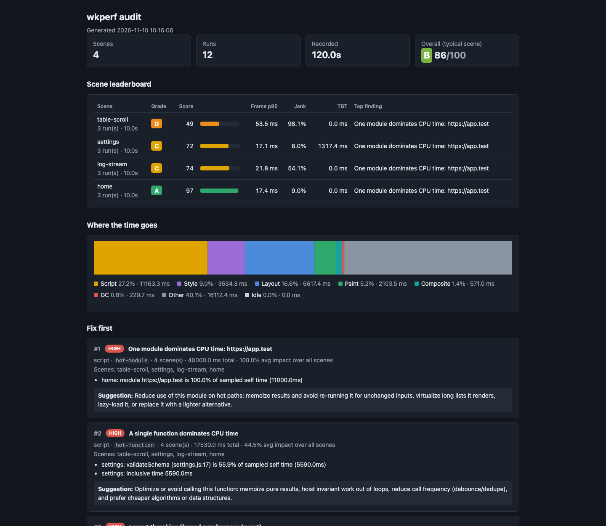
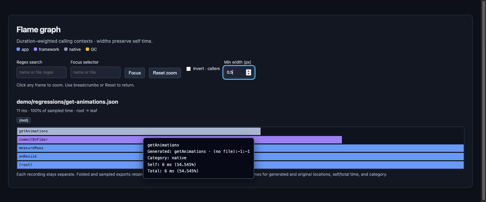

<p align="center">
  
</p>

<h1 align="center">wkperf</h1>

<p align="center">Find the slow frames. Fix the hot paths. Prove the improvement.</p>

<p align="center">
  <a href="https://github.com/omniviewdev/wkperf/actions/workflows/ci.yaml"></a>
  <a href="https://github.com/omniviewdev/wkperf/tags"></a>
  <a href="https://go.dev/dl/"></a>
  <a href="docs/REFERENCE.md"></a>
</p>

<p align="center">
  <a href="#install">Install</a> ·
  <a href="#try-it-in-30-seconds">Quick start</a> ·
  <a href="#report-preview">Report preview</a> ·
  <a href="docs/REFERENCE.md">Reference</a>
</p>

**Find what makes your WebKit UI slow—and give your coding agent enough evidence to fix it.**

`wkperf` reads Safari and WKWebView Web Inspector Timelines exports, including Safari's wrapped export format.

- **`compare`**: put a *before* and an *after* side by side. See what got faster, what got slower, and what is just noise.
- **`analyze`**: look at one recording and see where the time goes, which functions are hot, which frames were slow and why, plus concrete suggestions.
- **`--ai`**: hand the findings to an LLM (Claude, OpenAI, or a local model) for a ranked fix list, or print the prompt and paste it into your own agent.

Output is a terminal report, a single self-contained HTML file you can share, or JSON for CI.

## Install

### Install with Go

Install [Go 1.26.1 or newer](https://go.dev/dl/), then run:

```bash
go install github.com/omniviewdev/wkperf@latest
wkperf version
```

No GitHub account, API key, or private-repository configuration is required. AI features are optional.

If your shell says `wkperf: command not found`, add Go's binary directory to your `PATH`:

```bash
# macOS / Linux; add this line to ~/.zshrc or ~/.bashrc to keep it.
export PATH="$(go env GOPATH)/bin:$PATH"
wkperf version
```

If you set `GOBIN`, add that directory instead. On Windows, add `%USERPROFILE%\go\bin` to your user `Path`.

For a reproducible install, replace `@latest` with a tag, such as `@v0.4.0`.

<details>
<summary>Build from source</summary>

```bash
git clone https://github.com/omniviewdev/wkperf.git
cd wkperf
GOWORK=off go build -o wkperf .
./wkperf version
```

</details>

## Try it in 30 seconds

No recording needed. Generate some fake ones:

```bash
wkperf sample --wrapped --out demo
wkperf compare demo/baseline-*.json --vs demo/candidate-*.json
wkperf analyze demo/baseline-1.json
wkperf query demo/regressions/get-animations.json hot-path
wkperf flame demo/regressions/get-animations.json --format html --out flame.html
```

Terminal output highlights improved, regressed, unchanged, and noisy metrics. Several runs per side are needed to estimate variability.

Add `--format html --out report.html --open` for the shareable version with charts.

## Report preview



*Captured from the actual HTML report using bundled synthetic scenes—not an application benchmark.*

Recreate it:

```bash
wkperf sample --out demo
wkperf audit demo/scenes --format html --out audit.html --open
```

Reports are standalone HTML files. Share the file directly; recipients do not need wkperf or a server.

### Interactive flame graphs



*Synthetic stack fixture. Widths represent sampled time, not elapsed recording time.*

```bash
wkperf flame demo/regressions/get-animations.json --out flame.html
```

Click to zoom, search with a regex, invert the call view, or export SVG, folded stacks, Speedscope, and JSON.

## The real workflow

### 1. Record

In Web Inspector, open the **Timelines** tab, make sure **JavaScript & Events**, **Layout & Rendering**, **CPU** and **Memory** are enabled, record the scenario, stop, and use the **Export** button to save the `.json`.

A few habits make results trustworthy:

- **Do exactly the same thing every time**: same steps, same data, about the same length.
- **Record 5 runs per side** and put them in `baseline/` and `candidate/`. `wkperf` compares medians and calls out changes that are within normal run-to-run wobble.
- Use a warm app (do a throwaway run first) unless startup is what you're measuring.

### 2. Find out what's slow

```bash
wkperf analyze baseline/run-1.json
```

You get:

- **Where the time goes**: script, style, layout, paint, GC, as a share of the recording.
- **Hot functions and modules**: what the sampling profiler spent time in.
- **Slow frames and idle wakeups**: separate expensive rendering from periodic timers waking an otherwise idle app.
- **Checkable findings**: evidence, implicated functions, confidence, metric targets, and windows to inspect next—not proof of causation.

### 3. Get help fixing it

```bash
export ANTHROPIC_API_KEY=...
wkperf analyze baseline/run-1.json --ai
```

Or skip the API and take the prompt with you (no network, no key):

```bash
wkperf analyze baseline/run-1.json --emit-prompt=prompt.md
```

The prompt tells the model to stick to the measured data, rank fixes by impact and effort, and say which metric should move to prove each fix worked. Local models work too (Ollama, LM Studio) through `--ai-provider openai --ai-base-url ...`. API keys are read from the environment only.

### 4. Check that it worked

Make the change, record again, then:

```bash
wkperf compare baseline/ --vs candidate/
```

### 5. Keep it from regressing (optional)

```bash
wkperf compare baseline/ --vs candidate/ --fail-on-regression --strict-fixture
```

Exit code `2` means a threshold-exceeding regression in a gated metric; it is not statistical proof. Code `3` means the comparability gate failed. Details are in the [reference](docs/REFERENCE.md#exit-codes).

## Audit one build across many scenes

`compare` answers "did my change help?". `audit` answers "how healthy is this build overall, and what should I fix first?". Record several scenes of the *same* build (home, a big table, a log view, settings...), one folder per scene:

```
scenes/
  home/           run-1.json  run-2.json  run-3.json
  table-scroll/   run-1.json  run-2.json  run-3.json
  log-stream/     run-1.json  run-2.json
  settings.json                      # a loose file is its own scene
```

```bash
wkperf sample --out /tmp/demo          # includes a demo scenes/ tree
wkperf audit /tmp/demo/scenes
wkperf audit scenes/ --format html --out audit.html --open
wkperf audit scenes/ --min-score 70    # exit code 4 below 70: gate CI on the whole app
wkperf audit captures/ --group-by-prefix   # home-1.json, home-2.json -> scene "home"
```

Each subdirectory is a scene (its files are repeat runs, medians are used); loose files are one scene each. You get a scene leaderboard, an overall grade, where the time goes, a cross-scene **Fix first** list (ranked by how many scenes a problem hits times how much it costs), hot functions, and the worst scene per standard. `--ai` / `--emit-prompt` work as in `analyze`.

Reports retain per-scene details so a healthy median cannot hide a bad scene. Failed files are listed individually; valid recordings are still analyzed, and the command exits nonzero.

## How far from a performant UI?

`analyze` and `audit` rate recordings against adapted published targets and wkperf-specific heuristics. They show the distance to "good". Scores run 0 to 100, graded A (90+), B (75+), C (60+), D (40+), F. `analyze --no-scorecard` hides the scorecard.

An honest note: this is **not Lighthouse and not Core Web Vitals scoring**. Those tools measure page loads in a browser; wkperf reads Web Inspector timelines of a long-lived app.

- **Borrowed from Lighthouse / Core Web Vitals**: Total Blocking Time (summed over the whole recording and normalized per 10 s, not FCP-to-TTI), an INP *approximation* (handler time only, no input or presentation delay, so real INP is higher), and FCP/LCP only when the recording actually contains those records.
- **Not used**: CLS and any page-load scoring.
- **wkperf-specific**: frame budget (p95, FPS), jank ratio, GC share, memory growth, forced layouts per second, long tasks per minute, main-thread busy share. Their thresholds are our choices for a desktop webview app, not a standard.

| Standard | Source | ID | Good | Poor | Weight |
| --- | --- | --- | --- | --- | --- |
| Frame time p95 | frame budget (60Hz) | `frame-p95` | ≤ 16.7 ms | > 33.4 ms | 3 |
| Jank ratio | frame budget (60Hz) | `jank-ratio` | ≤ 5% | > 25% | 3 |
| Average FPS | frame budget (60Hz) | `fps` | ≥ 55 | < 30 | 3 |
| Total Blocking Time | Lighthouse | `tbt` | ≤ 200 ms per 10 s | > 600 ms per 10 s | 2 |
| Interaction latency (INP approx.) | Core Web Vitals | `inp` | ≤ 200 ms | > 500 ms | 2 |
| Long tasks per minute | wkperf heuristic | `long-task-rate` | ≤ 3 | > 12 | 2 |
| First Contentful Paint | Lighthouse | `fcp` | ≤ 1800 ms | > 3000 ms | 1 |
| Largest Contentful Paint | Core Web Vitals | `lcp` | ≤ 2500 ms | > 4000 ms | 1 |
| Main thread script busy | wkperf heuristic | `main-busy` | ≤ 25% | > 50% | 1 |
| GC share of wall time | wkperf heuristic | `gc-share` | ≤ 3% | > 10% | 1 |
| Memory growth | wkperf heuristic | `memory-growth` | ≤ 1 MB/min | > 10 MB/min | 1 |
| Forced layouts per second | wkperf heuristic | `forced-layout-rate` | ≤ 0.5 /s | > 5 /s | 1 |

Treat scores as a compass, not a certificate.

## "My two recordings aren't the same length / scenario"

That's common, and `wkperf` deals with it instead of silently lying:

- If lengths differ by more than 10%, totals and counts are compared **per second**, and labeled that way.
- `--trim-start 2 --trim-end 1` drops warm-up and tail; `--from` / `--to` compares the same slice of each recording.
- Every comparison gets a **comparability score** (0 to 1) and warnings: different duration, different frame rate, different URLs, different hot code paths ("you may be measuring a different workload"), too few samples, or noisy runs.

Normalization is a safety net. The best fix is still recording the same scenario.

## Agent workflow

Keep the complete JSON as the evidence artifact; use bounded Markdown or targeted queries for a coding agent's context.

```bash
# Resolve bundled code back to source and get a compact diagnosis.
wkperf analyze recording.json --sourcemap ./dist --format md --brief
wkperf analyze recording.json --sourcemap ./dist --format json > analysis.json

# Follow the expensive chain, then inspect the exact function or stack.
wkperf query recording.json hot-path
wkperf query recording.json top --by total --limit 10
wkperf query recording.json callers performSyncWorkOnRoot
wkperf query recording.json paths getAnimations --limit 5

# Explore the same evidence visually.
wkperf flame recording.json --format html --out flame.html

# After a source change, record the same scenario at least five times per side.
wkperf compare baseline/ --vs candidate/ --format md --fail-on-regression
```

Ambiguous function names produce candidate IDs instead of silently choosing a function. Use an ID or `url:line:col` to select precisely. Findings include suggested time windows and commands to reproduce their supporting measurements.

The unreleased fixes use `wkperf-insights/v3` and `wkperf-audit/v2`; v0.4.0 emits analysis v2 and audit v1. Run `wkperf schema` for the checked-out binary's complete contract. Untimed samples remain in whole-recording rankings but are explicitly excluded from temporal attribution. Bad files do not discard valid analyze/audit results: failures appear in `errors` and stderr, and the command exits nonzero.

Use `wkperf analyze capture.json --brief --max-bytes 12000` for a bounded terminal report, or add `--format md` for Markdown. Sources, errors, and finding summaries take priority over detail. JSON stores selected frames and exact stacks once, with references, totals, and retrieval commands instead of repeated stack dumps. Use `--out -` to write a single-format analysis report to stdout.

Idle timer wakeups are separated from expensive frames. Function identity includes columns, so minified same-line functions stay distinct. Source maps show original and generated locations together; file-level module grouping keeps plugin bundles separate. Use `--module-grouping parent-directory` only when you want a directory roll-up.

Long tasks now share non-overlapping task boundaries across metrics, findings, and window selection. GC collector intervals stay separate from main-thread work. Input stalls stay visible without inflating work-bound jank. Sparse or mostly idle captures receive unavailable grades rather than a misleading healthy score; frame standards require 30 active frames and one second of active-frame observation.

Source maps resolve locations without borrowing parameter names for function labels. Copied sidecars keep honest relative source paths when originals are unavailable, and directory scans skip unrelated unsupported maps with warnings. MCP reports the installed tool version, rejects non-file inputs, and recovers after oversized requests.

For tool-based agents, `wkperf mcp` exposes the query engine through MCP over stdio. It writes protocol messages—not logging—to stdout. See the [reference](docs/REFERENCE.md) for formats, query operations, source maps, and JSON schemas.

## What it will and won't tell you

- Findings are **heuristics**, not proof. Treat them as leads and confirm with a second capture.
- A single run has no noise estimate. Comparisons explicitly identify single-run confidence; capture at least five runs per side.
- AI answers are only as good as the data in the prompt. Check the suggestions before shipping them.

## More

Full flag tables, the findings catalogue, config file, metric glossary and CI examples are in [docs/REFERENCE.md](docs/REFERENCE.md). Design notes are in [PLAN.md](PLAN.md).
