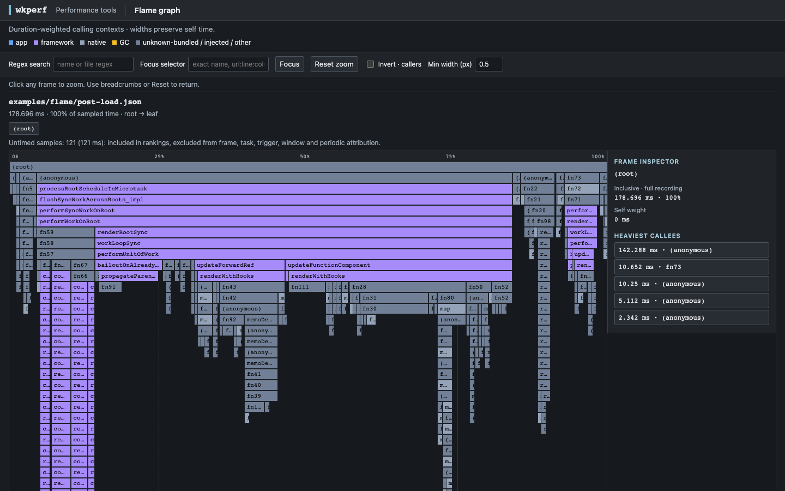
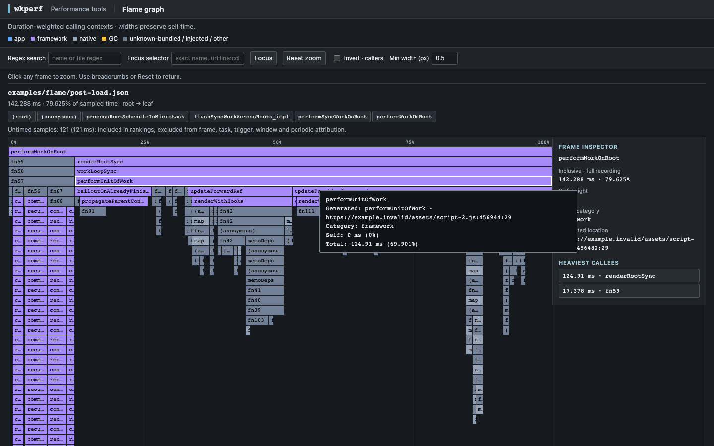
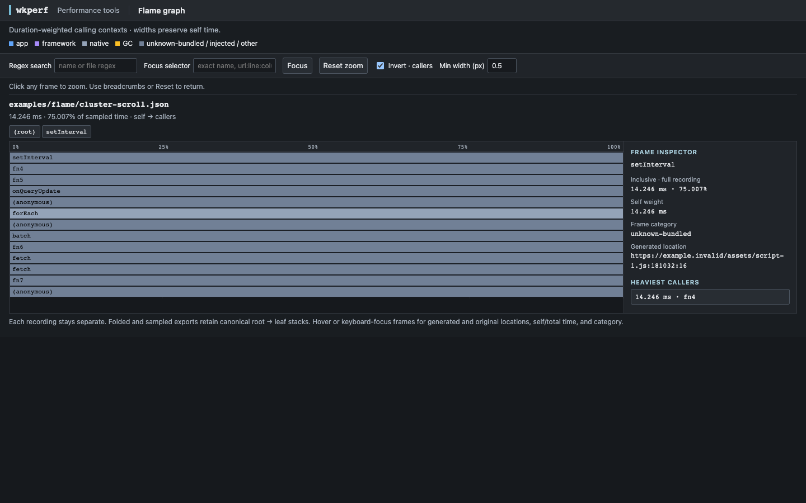
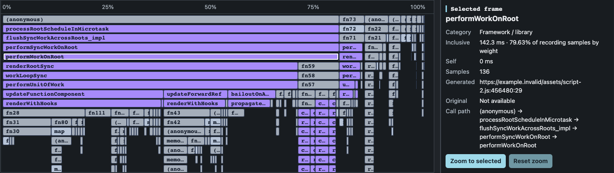

# Investigate a deep WebKit profile

These are actual Omniview recordings, not generated load shapes. The public examples contain only the sampled JavaScript stacks. Source URLs are replaced with `example.invalid` aliases; non-allowlisted function names become `fnN`. Stack order, depth, timestamps, and sample durations are preserved. The examples omit timeline events, application payloads and source maps. Do not use them to infer missed frames or compare the two different workloads as a regression test.

From a checkout, generate two self-contained HTML files and open them in a browser:

```sh
wkperf flame examples/flame/post-load.json --out post-load.html
wkperf flame examples/flame/cluster-scroll.json --invert --out callers.html
```

## 1. Find the dominant branch



Open `post-load.html`. The post-load capture contains 180 samples; its deepest raw stack has 365 frames. The root shows **178.696 ms** of sample weight. The widest branch accounts for **142.288 ms**. Follow it down to `performWorkOnRoot`. The ruler measures the fraction of visible stack weight, not chronological time. Repeated purple rows deeper in the graph are nested framework calls, not separate time intervals to add together.

## 2. Decide whether the function itself is expensive



Click the widest `performWorkOnRoot` rectangle. The inspector reports **79.625% inclusive, 0 ms self**. `renderRootSync` is the heavier of its two immediate children; select it from the inspector to follow the work. Alternatively, hover `performUnitOfWork` to preview its **124.910 ms** without losing your zoom. Use the breadcrumb to back out. The wide parent is an investigation starting point, not evidence that changing that function will make the app faster.

## 3. Ask who called a hot leaf



Open `callers.html`. Select `setInterval` from the inspector. This one sample carries **14.246 ms**, or **75.007%** of the short capture's **18.993 ms**. Inversion places its callers below it. The capture has just 11 samples: repeat the interaction before blaming timer setup. Sample weight is not a measured wall-clock duration for an individual `setInterval` call.

## 4. Cross-check attribution in the local investigator



Run `wkperf ui --open`, upload `examples/flame/post-load.json` as the baseline, and choose **Analyze recordings**. In **Flame graph**, select the widest `performWorkOnRoot`. The inspector independently displays the same rounded weight (**142.3 ms**) across **136 samples**, the generated location, and the caller chain. Of all 180 samples, 121 have no usable timestamp. They support aggregate rankings, not a claim that this work caused a particular slow frame.

## Design references

- [Omniview UI](https://github.com/omniviewdev/ui): compact grouped toolbars, restrained separators, and a distinct inspector pane instead of dashboard cards.
- [Chrome DevTools Performance](https://developer.chrome.com/docs/devtools/performance/reference#read-the-flame-chart): coordinated selection, zoom, and source details. Unlike Chrome's timeline chart, this graph groups calling contexts by weight.
- [speedscope views](https://github.com/jlfwong/speedscope#views): separate the questions “where did the work accumulate?” and “who called this leaf?” Root-first and inverted views answer different questions with the same samples.
